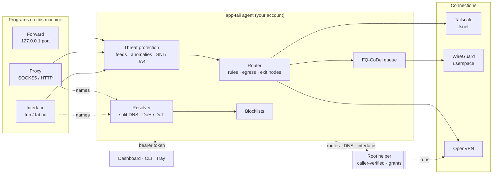
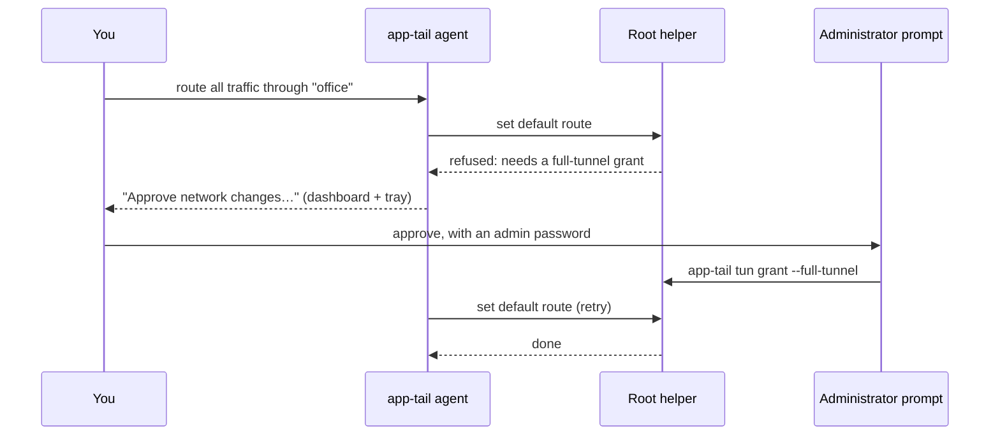

<p align="center">
  <picture>
    <source media="(prefers-color-scheme: dark)" srcset="docs/assets/hero-dark.svg">
    <source media="(prefers-color-scheme: light)" srcset="docs/assets/hero-light.svg">
    
  </picture>
</p>

<p align="center">
  <a href="https://github.com/Sellitus/app-tail/actions/workflows/ci.yml"></a>
  
  
  
  <a href="LICENSE"></a>
</p>

<p align="center">
  <a href="#quick-start"><b>Quick start</b></a> ·
  <a href="#what-it-protects-you-from"><b>Protection</b></a> ·
  <a href="#how-it-works"><b>How it works</b></a> ·
  <a href="#every-feature-one-switch-each"><b>Features</b></a> ·
  <a href="SECURITY.md"><b>Threat model</b></a> ·
  <a href="docs/"><b>Docs</b></a>
</p>

---

## In thirty seconds

You probably belong to more than one private network. A work tailnet, a WireGuard server at
home, a client's OpenVPN. Most VPN apps let you be on one at a time, and they take over the
whole machine to do it.

**app-tail runs all of them at once, side by side**, and lets you decide how much of your
machine each one gets: a single port, a proxy that only some programs use, or a real network
interface for everything. Two networks that both use `10.0.0.0/8` work at the same time.

Along the way it guards the traffic it carries: encrypted DNS, blocklists for ads, trackers
and malware, threat feeds of known-bad servers, and a kill switch so traffic never quietly
falls back to your coffee-shop Wi-Fi.

It's one program with a dashboard built in. **Out of the box it changes nothing on your
machine** and needs no administrator rights. Each feature has one switch, and the few that
touch the whole machine ask an administrator first.

## What it protects you from

<table>
<tr>
<td width="33%" valign="top">

**Ads, trackers and malware domains**<br>
DNS blocking with 45 lists from 16 publishers, or one of six ready-made levels from
*Minimum* to *Ultimate*. Lists keep working from disk when the internet doesn't.

</td>
<td width="33%" valign="top">

**Known-bad servers**<br>
Threat protection checks every connection app-tail carries against 17 threat feeds
(Spamhaus, FireHOL, abuse.ch and more). Start by watching, then switch to refusing.

</td>
<td width="33%" valign="top">

**Someone reading your lookups**<br>
DNS over HTTPS and DNS over TLS, with Quad9, Cloudflare and Google built in and room for
your own. Names on a private network are only ever asked of that network.

</td>
</tr>
<tr>
<td valign="top">

**Leaks when a VPN drops**<br>
With the kill switch on, internet traffic waits for the connection you chose instead of
slipping out over whatever network you're on. Exit-node failures hold, too.

</td>
<td valign="top">

**Uninvited visitors**<br>
Shields drop every connection other tailnet devices try to open to you, whatever the
tailnet's rules allow. You can still reach out.

</td>
<td valign="top">

**Other software on your computer**<br>
The dashboard API, the stored keys and the root helper each check who's asking. Details
are in [defense in depth](#defense-in-depth).

</td>
</tr>
</table>

> [!NOTE]
> Threat protection covers the traffic app-tail itself carries: its proxy, its port forwards,
> fabric mode, and traffic other devices route through this one. DNS blocking covers
> app-tail's own lookups, and the whole machine's once app-tail is its resolver. Neither
> replaces antivirus. [docs/security.md](docs/security.md) has the exact reach of each.

## Quick start

**1. Install.** Grab the release for your system and check it against `SHA256SUMS.txt`
([install notes](docs/install.md)), or build from source:

```sh
./setup.sh            # Go, Node and the tools the build checks with
./build_install.sh    # builds the dashboard and the binary, installs it
```

**2. Start it and sign in to your tailnet.**

```sh
app-tail              # starts the agent, the tray icon and the dashboard
app-tail login        # prints the link that adds this device to your tailnet
app-tail dashboard    # opens the dashboard, already signed in
```

**3. Pick how much of the machine your networks get.** Any of these, in any combination:

```sh
# One service, nothing else: a GPU box's port 8100 becomes localhost:18100
app-tail add --name "LLM on gpu-box" --target 100.64.0.5:8100 --port 18100

# A proxy for the programs you point at it (SOCKS5 and HTTP on one port)
app-tail settings set --proxy=true
app-tail exec -- curl http://gpu-box.tail1a2b3c.ts.net:8100/

# Every program on the machine, every connected network, one interface
app-tail settings set --interface=true --interface-mode=fabric
```

**4. Add the rest of your networks.**

```sh
app-tail connection add --type wireguard --name home   --from-file home.conf
app-tail connection add --type openvpn   --name client --from-file client.ovpn
app-tail connection list
```

**5. Turn on the protection you want.**

```sh
app-tail dns block on                         # DNS blocking
app-tail dns block level high                 # a ready-made set of lists
app-tail settings set --ips=true              # threat protection, watching only
app-tail settings set --ips-mode=prevent      # ...now refusing
app-tail health                               # is everything ready to carry traffic?
```

Every one of these is also a switch in the dashboard and, for the main features, the tray
menu. [The full command list](docs/cli.md) is generated from the binary itself.

## How it works

<p align="center">
  <picture>
    <source media="(prefers-color-scheme: dark)" srcset="docs/assets/architecture-dark.svg">
    <source media="(prefers-color-scheme: light)" srcset="docs/assets/architecture-light.svg">
    
  </picture>
</p>

### Three ways in

| | What reaches your networks | Admin rights |
|---|---|---|
| **Port forwards** | one local port per service, chosen by you | no |
| **Proxy** | any program pointed at `127.0.0.1:1080`: SOCKS5 and HTTP on one port, plus a PAC file for browsers | no |
| **Network interface** | every program on this machine, through a real network device | once |

They stack. Forwards always work, and turning on the interface doesn't switch the proxy off.

The interface comes in two forms. **tun** puts your tailnet on the machine, the way the
official Tailscale client does. **Fabric** puts *every* connected network on one interface.
When two networks use the same addresses, fabric presents the second from a spare range
(`198.18.0.0/15`) and translates on the way back, so both stay reachable. Fabric carries TCP
and UDP only, and every byte passes through app-tail. [The full trade-off](docs/modes.md#fabric-every-network-at-once).

### Three kinds of network

| | How it connects | What it changes on the machine |
|---|---|---|
| **Tailscale** | its own [`tsnet`](https://tailscale.com/kb/1244/tsnet) node inside app-tail, enrolled as its own device | nothing |
| **WireGuard** | a userspace device inside app-tail | nothing |
| **OpenVPN** | the system's `openvpn`, started by the root helper | a network interface appears (macOS and Linux) |

Each connection answers for its own name suffix: a host on `office` is `db.office.internal`
and one on `lab` is `db.lab.internal`, even when both are `10.0.0.5`. Internet traffic can
go out directly, through one connection, spread across several, or cascade through them in
order. Per-destination rules send chosen addresses through a different connection, straight
out, or nowhere. See [Connections](docs/connections.md) and [Routing](docs/routing.md).

<details>
<summary><b>Under the hood</b>: the agent's moving parts, for the technically curious</summary>

<br>



- **Userspace first.** Tailscale and WireGuard connections live entirely inside the
  process. Nothing on the machine changes until you ask for the interface or the system-wide
  resolver.
- **Fair queueing.** Each WireGuard connection runs its own FQ-CoDel queue, so a big
  download can't add a quarter second to every keystroke of an SSH session sharing it.
- **One registry.** Every setting is declared once in Go. The dashboard's forms, the tray's
  checkboxes, `app-tail settings` and the TypeScript types are all generated from it, so
  the three surfaces can't disagree.
- **One agent per config.** A second start asks the first to shut down, waits for it to put
  the machine's resolver, proxy settings and routes back, and only then takes over.

</details>

## Defense in depth

A VPN client is a juicy target: it can see your traffic and it can change your network. So
app-tail treats every way in as hostile until it proves otherwise.

<p align="center">
  <picture>
    <source media="(prefers-color-scheme: dark)" srcset="docs/assets/defense-dark.svg">
    <source media="(prefers-color-scheme: light)" srcset="docs/assets/defense-light.svg">
    
  </picture>
</p>

<details>
<summary><b>How each wall is built</b></summary>

<br>

**Token-locked API.** The dashboard API listens on loopback only, and the config refuses any
other address, even when hand-edited. Every call needs a 256-bit token stored in a file only
your account can read. Only sign-in, the health check and the proxy's PAC file answer
without it. Browsers sign in with a one-time link that expires in two minutes.
The CLI makes whatever is listening prove it holds the token *before* sending it, so a
program squatting on the port learns nothing. `app-tail auth rotate` signs everyone out.

**Owner-only state.** The token, `config.json` and `secrets.json` are mode `0600` and
written by atomic rename. Credentials live only in `secrets.json`, so `config.json` is safe
to diff or attach to a bug report. On Windows the secrets are also DPAPI-encrypted to your
account. A tailnet key is bound to the control server it was entered for and is never handed
to another one.

**Verified helper callers.** The root helper serves only the account that installed it, and
checks that the calling process is running app-tail itself: on macOS by comparing the
kernel's code-signature hash, on Linux by comparing the running program and refusing a
traced process. Safe changes, like a private route that doesn't cover your LAN, go through.
Big ones need an administrator's approval first, recorded in a root-owned `grants.json`:



Full tunnels, public routes, the system-wide resolver, each OpenVPN server with its CA and
TLS interception each need their own approval.

**Root-owned programs only.** Before root runs anything, like `openvpn`, every folder above
it and every library it loads must be owned by root and writable by nobody else. A program
that carries its own loader settings is refused. macOS releases use the hardened runtime, so
libraries can't be injected into the helper.

**Shields and approved routes.** Shields drop inbound tailnet connections. When this device
shares a subnet, traffic arriving over the tailnet reaches only the addresses the tailnet
approved, never this machine's own loopback.

**Threat feeds and blocklists.** DNS blocking refuses names before a lookup leaves the
machine. Threat protection matches destinations against feeds and can also read TLS server
names, JA4 fingerprints and signs of port scans or DNS tunnelling. Opening encrypted traffic
for inspection is off unless you agree to it *and* pick a scope, and the root certificate it
makes is limited by name constraints to exactly that scope.

</details>

Read [SECURITY.md](SECURITY.md) for the full threat model, including what app-tail
deliberately doesn't defend against.

## Every feature, one switch each

| Feature | What it does | Switch | Starts |
|---|---|---|---|
| **Connections** | Tailscale, WireGuard and OpenVPN, as many as you like | per connection | on when added |
| **Port forwards** | one remote service on one local port, in either direction | per forward | on when added |
| **Automatic ports** | a local port for every device on the tailnet, kept stable | `automap` | off |
| **Proxy** | SOCKS5 + HTTP on one loopback port, PAC file, optional password | `proxy` | off |
| **Network interface** | tun (tailnet) or fabric (every network) for every program | `interface` | off |
| **Internet** | direct, one connection, or several (spread or cascade), plus kill switch | `egress` | direct |
| **Exit nodes** | send internet traffic through a tailnet device, with failover and rotation | `exit-node` | off |
| **Split tunneling** | per-destination rules: via a connection, direct, or blocked | `app-tail route` | no rules |
| **System DNS** | make app-tail this machine's resolver, with encrypted profiles | `system-dns` | off |
| **Private names** | `host.connection.internal` for every connection, never asked of the wrong network | always on | on |
| **DNS blocking** | 45 lists, six levels, allow and deny lists, pause | `dns-block` | off |
| **Threat protection** | 17 threat feeds, detect or prevent, anomaly and handshake checks | `ips` | off |
| **TLS inspection** | open encrypted traffic to chosen destinations for inspection | `ips-intercept` | off |
| **Shields** | refuse every inbound tailnet connection | `security` + `shields-up` | off |
| **Traffic meter** | live throughput per connection, with an optional latency probe | always on; probe is `traffic-latency` | on |
| **Activity log** | what the agent did and why, filterable, also `app-tail log --follow` | `telemetry` | off |
| **Tailnet lock** | see why lock holds this device, sign a node | `app-tail lock` | |
| **Fleet setup** | provision machines from a profile, draft the tailnet policy | `app-tail provision` | |

Switches are `app-tail settings set --<name>=<value>`, a toggle in the dashboard, and for the
main features a checkbox in the tray. [docs/configuration.md](docs/configuration.md) covers
the rest, including which settings take effect only after a restart.

## Runs on

| | macOS | Windows | Linux |
|---|:-:|:-:|:-:|
| Forwards, proxy, private names | ✓ | ✓ | ✓ |
| Network interface and fabric | ✓ | ✓ | ✓ |
| System DNS | ✓ | ✓ | ✓ (systemd-resolved) |
| OpenVPN connections | ✓ | | ✓ |
| Root helper | installs on first use | not needed, asks to elevate | run by hand, [as in Modes](docs/modes.md#macos-and-linux-a-small-root-helper) |
| System proxy settings | | ✓ | |
| Tray icon | ✓ | ✓ | dashboard only |

Released as an `App-Tail.app` zip for macOS, a zip with two `.exe` files (console and GUI) and
`wintun.dll` for Windows, and a single binary for Linux. On Windows,
`app-tail install` copies it into Program Files so only administrators can change it. A
Docker image is described in [Deployment](docs/deployment.md).

## How conflicts are handled

- **Overlapping subnets in fabric mode are re-addressed for you.** This is the one conflict
  app-tail resolves instead of reporting.
- **Two IPv6 networks that collide are reported.** The spare pool is IPv4 only.
- **Duplicate ports, proxy addresses and connection names are refused when you set them**,
  with the reason.
- **Everything else is reported, not guessed at.** A route another program owns, a resolver
  something else changed, an interface left by a crash: `app-tail health` and
  `app-tail tun doctor` are where those show up.
- **Running the official Tailscale client at the same time** is fine for forwards and the
  proxy. The tun interface waits for it to quit, since two clients can't share one adapter.

## Documentation

| | |
|---|---|
| [Install](docs/install.md) | releases, building from source, first run |
| [Modes](docs/modes.md) | forwards, proxy, tun and fabric, the root helper |
| [Connections](docs/connections.md) | Tailscale, WireGuard, OpenVPN, chaining, egress |
| [Routing](docs/routing.md) | subnet routes, exit nodes, per-destination rules |
| [DNS](docs/dns.md) | profiles, private names, blocklists, the system resolver |
| [Security](docs/security.md) | shields, inspection, approvals, where credentials live |
| [CLI](docs/cli.md) | every command, checked against the binary |
| [API](docs/api.md) | the HTTP API and how to authenticate |
| [Configuration](docs/configuration.md) | state directory, environment, restart-required settings |
| [Deployment](docs/deployment.md) | Docker, fleets, autostart, a remote dashboard over SSH |
| [Troubleshooting](docs/troubleshooting.md) | when something's wrong |
| [Releasing](docs/releasing.md) | how a release is built |

<details>
<summary><b>Where things live in the code</b></summary>

```
main.go, controller.go     process startup, the agent's lifecycle, the tray's actions
internal/app/              the agent: wires every module together
internal/tsnode/           the Tailscale node and its userspace stack
internal/tunnel/           WireGuard and OpenVPN connections
internal/fabric/           one interface across every connection
internal/forward/          port forwards
internal/tsproxy/          the SOCKS5 + HTTP proxy
internal/dnsfwd/           the resolver, profiles and blocklists
internal/inspect/          threat protection: matching, anomalies, TLS inspection
internal/dnsblock/         DNS blocklists and their levels
internal/httpapi/          the loopback API the dashboard and CLI share
internal/apiauth/          API tokens, launch links and sessions
internal/config/           the settings registry everything is generated from
internal/secretstore/      secrets.json, kept apart from the config
internal/hostnet/          the root helper and everything it touches
internal/grants/           administrator approvals
ui/                        the React dashboard, compiled into the binary
```

</details>

## Contributing

Bug reports and pull requests are welcome. `./verify.sh` and `./test.sh` must pass:
together they run gofmt, golangci-lint, eslint, shellcheck, govulncheck, gitleaks, the full
Go and dashboard test suites with the race detector, and cross-builds for every release
target. [CONTRIBUTING.md](CONTRIBUTING.md) covers the build, the manual checks that need a
real tailnet, and how to add a connection type. Everyone is expected to follow the
[Code of Conduct](CODE_OF_CONDUCT.md).

Found a security problem? Please report it privately as described in
[SECURITY.md](SECURITY.md), not in a public issue.

## License

MIT, see [LICENSE](LICENSE). Bundled third-party components keep their own terms, printed
in full by `app-tail licenses`: `wintun.dll` is WireGuard LLC's, redistributed unmodified in
the Windows zip, and OpenVPN (GPL-2.0) is installed separately and run as its own program,
never linked. The dashboard's dependencies and typefaces are listed in
[ui/THIRD_PARTY_NOTICES.md](ui/THIRD_PARTY_NOTICES.md).
